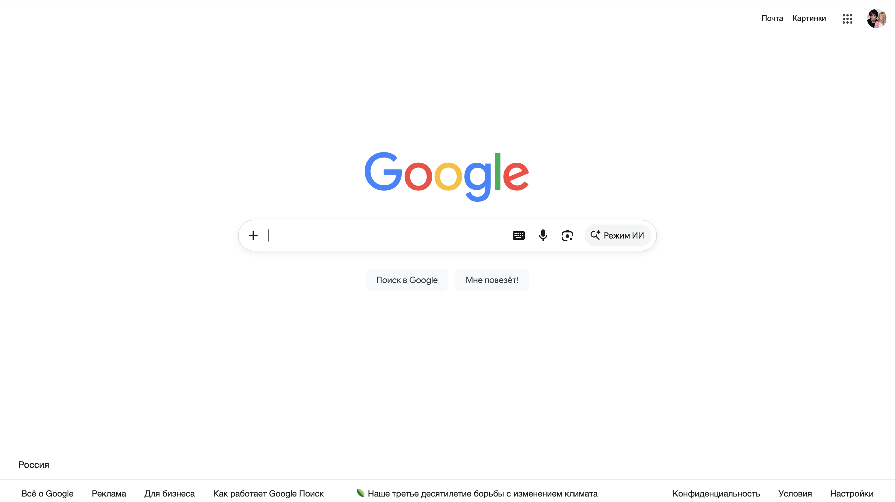
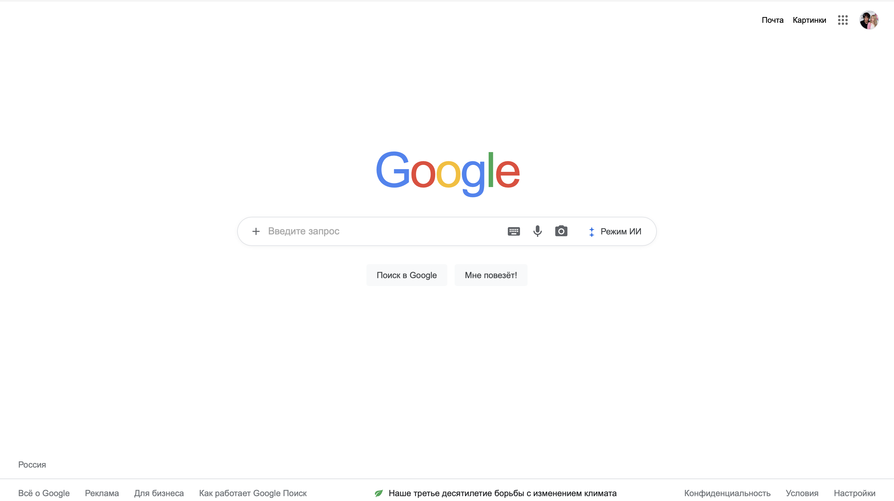

# Главная страница (Clone)

## 📂 Структура проекта

Ниже представлена актуальная структура файлов и папок проекта:

```text
Gs/ 
├── css/
│   └── style.css             # CSS
├── html/
│   └── index.html            # HTML и ссылки на стили со скриптом 
├── img/
│   ├── .jpg                  # аватарка в шапке и меню (по умолчанию)
│   └── icons8-google-48.png  # Иконка сайта 
└── js/
    └── script.js             # JS
```

---

## 📸 Демонстрация

Здесь представлены скриншоты оригинального сайта и созданного клона.

### Оригинал (Google)

<!-- Используем HTML-тег img, чтобы указать точный путь и задать ширину -->


### Клон проекта



